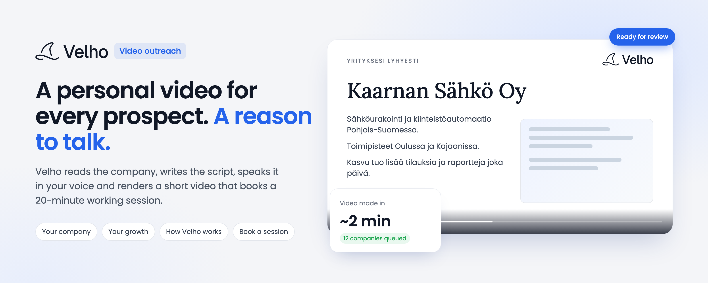

# Velho Video Outreach

Velho Video Outreach makes a short personal video for the owner of a growing B2B company. The tool reads the company website, writes the script, speaks it in the voice of the sender and renders the video. The owner gets a link. The link opens a page with the video, a short form and a calendar that books a 20-minute working session with Velho.

Built for the [Velho challenge](https://prompthack.aaltoes.com/hackathon-04/challenges/velho) at Aaltoes Prompt Hackathon 04. Velho is a strategic AI growth partner. It finds the manual work that slows a company down, builds the fix with AI and automation, and makes sure people actually use it. The video tells that story to one company at a time.

**Live demo:** https://velho-video-outreach.bobs.build

## The video

| Slide | What it says |
|---|---|
| 1. Intro | The face-cam intro of the sender. |
| 2. Your company | What the company does, read from its website, and where a company like it usually loses time to manual work. |
| 3. Your growth | Revenue and profit from public figures, and why growth adds manual work. Without figures, the owner gives the team size in the form. |
| 4. How Velho works | Find the manual work, build the fix with AI and automation, make sure people use it. |
| 5. Book a working session | 20 minutes on Teams: pick one manual workflow and sketch a practical fix. |

The video speaks Finnish, Swedish, Norwegian, Danish, German or English, based on the company. The tool records how the owner watches, moves the deal through the pipeline, makes follow-up tasks and writes a meeting brief before each session.

## Repository layout

| Folder | Contents |
|---|---|
| `apps/server` | Hono API and worker (1 package, 2 entry points) |
| `apps/web` | Vite app for the admin panel and the video page |
| `apps/mgx-mock` | MCP server mock, buyer logos and the demo company websites |
| `packages/shared` | types, zod schemas, pure logic, i18n, template scripts |
| `packages/scene` | Revideo scene and render |
| `scripts` | Pipedrive setup and seed |
| `config` | Pipedrive field and stage IDs, brand and contact facts |
| `seed` | demo data for the fake providers, and the demo websites in `seed/sites` |
| `e2e` | Playwright tests |

## Requirements

- Node.js 24 or later
  - The code uses native type stripping.
- pnpm 10
- ffmpeg and ffprobe 8
- Google Chrome or Chrome for Testing
  - Revideo needs H.264 in WebCodecs. Open-source Chromium does not work.

## Start the demo

```sh
pnpm install
cp .env.example .env
pnpm dev
```

Open http://localhost:3000. The command starts four processes:

| Process | Address | Job |
|---|---|---|
| API | http://localhost:3000 | admin panel, video page, media, mock Asiakastieto |
| Worker | none | scrape, scripts, audio, render, Pipedrive writes, hourly sweep, backup |
| Mock MGX | http://localhost:3100 | MCP server, logos, demo company websites |
| Vite | http://localhost:5173 | front end modules in development |

Without API keys, each external service uses a local fake. The avatar in the top bar then shows an amber dot, and the avatar menu lists the "Demo providers":

| Service | Key | Fake |
|---|---|---|
| Pipedrive | `PIPEDRIVE_API_TOKEN`, `PIPEDRIVE_COMPANY_DOMAIN` | JSON store copied from `seed/pipedrive.json` |
| Firecrawl | `FIRECRAWL_API_KEY` | local Chrome scraper |
| Featherless (Kimi-K3) | `FEATHERLESS_API_KEY` | template writer in six languages |
| ElevenLabs | `ELEVENLABS_API_KEY` | macOS `say`, else silence |

For local tests without a face-cam intro or a voice clone, set `DEV_BYPASS=1`. Then a sender without an intro gets a 3 s placeholder clip, and a sender without a voice clone gets the macOS `say` voice. The bypass has no effect when `NODE_ENV` is `production`.

## Demo companies

The seed has 12 fictional Finnish companies that fit Velho's customers: established companies with real operations and a reason to talk now. Each one has a small website in `seed/sites`, which the mock MGX serves, and public figures in `seed/asiakastieto.json`. The email addresses use the reserved domain `example.com`, so no message goes to a real person.

| Company | Business | City | Why now |
|---|---|---|---|
| Pohjanmaan Ohutlevy Oy | sheet metal | Seinäjoki | hiring a production planner |
| Saimaan Terminaalit Oy | warehousing and logistics | Lappeenranta | new terminal in Kouvola |
| Hämeen Kiinteistöpalvelu Oy | property maintenance | Tampere | merged two local companies |
| Leipomo Kultajyvä Oy | bakery | Lahti | new retail chain customer |
| Kaarnan Sähkö Oy | electrical contracting | Oulu | new office in Kajaani |
| Lounais-Tilitoimisto Oy | accounting | Turku | fast client growth |
| Keski-Suomen Puutuote Oy | sawmill and wood products | Jyväskylä | new planing line |
| Vaasan Konehuolto Oy | machine maintenance | Vaasa | new service contracts |
| Kymen Tukkupalvelu Oy | food wholesale | Kotka | new webshop for restaurants |
| Itä-Suomen Rakennus Oy | construction | Joensuu | won public contracts |
| Satakunnan Kuljetus Oy | road freight | Pori | growing the fleet |
| Hämeenlinnan Hoivapalvelut Oy | elderly care | Hämeenlinna | two new care homes |

## Make a first video

1. Open the profile menu. Record the face-cam intro and its transcript in each language that you use. Upload a voice sample and the signed consent.
2. On the Deals page, select **Generate videos** and pick the companies.
3. Wait until the deal is in the Review stage, about two minutes. Check the scripts and the slides, then select **Approve and publish**.
4. Copy the link for a channel from the deal page.

## Deal stages

A deal moves forward through these stages. It does not move back.

1. **Draft**: the worker reads the website, writes the scripts, makes the audio and renders the video.
2. **Review**: the sender checks the scripts and the slides.
3. **Link sent**: the sender publishes the video, and the link is live.
4. **Opened**: the owner opens the link.
5. **Form sent**: the owner sends the form.
6. **Meeting booked**: the owner books a working session. The tool closes the open follow-up tasks for the deal.

A deal goes to **Failed** when a worker job fails. If the owner says "not right now" in the form, the deal goes to **Lost**, and the tool sets it to lost in Pipedrive with the reason.

## Connect a real Pipedrive account

Run `pnpm setup:pipedrive`. The script makes the custom fields and the stages in Pipedrive, writes `config/pipedrive.json` and fills the Video field. Run `pnpm seed:pipedrive` to copy the demo companies into your Pipedrive account. This step is optional.

The API reads the Pipedrive changes at a 10 s interval while an admin panel is open, and at a 60 s interval otherwise.

## Production

To build the tool, run `pnpm build`. To start the tool, run `pnpm start`. The live demo runs on a Verda CPU instance with systemd and Caddy. `deploy/mergero.service` is the service unit, and `scripts/deploy.sh` updates the server from `main`.

The admin panel has no sign-in. Run the tool on a private address, or behind your own access control.

## Checks

| Check | Command |
|---|---|
| Type check | `pnpm typecheck` |
| Lint | `pnpm lint` |
| Unit tests | `pnpm test` |
| End-to-end tests (Playwright, mobile Chrome and mobile Safari) | `pnpm e2e` |

Before the first e2e run, install WebKit with `pnpm exec playwright install webkit`.

## Data

All state is in the `storage/` folder: the SQLite database (in WAL mode) and the media files. Each hour, the sweep deletes the media, the sessions, the events and the meeting briefs of each expired link. Each day, the tool writes a backup to `storage/data/backups/` and keeps the last 14 backups.
